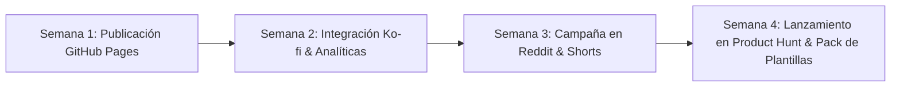

# 🚀 Plan Estratégico de Monetización Funcional y Promoción Viral
## MarkStudio Pro — Editor Markdown Multi-Plataforma

---

## 📌 1. Diagnóstico del Producto y Propuesta Única de Valor (USP)

### ¿Por qué MarkStudio Pro tiene alto potencial?
A diferencia de los editores Markdown genéricos (Dillinger, StackEdit o HackMD), **MarkStudio Pro resuelve un dolor real e inmediato que nadie más atiende**:
1. **Simulación en Tiempo Real de Redes:** Permite ver exactamente cómo se verá el texto en **WhatsApp** y **Discord** antes de enviarlo.
2. **Conversor Automático de Sintaxis:** Transforma con un clic Markdown estándar (`**negrita**`, `~~tachado~~`, `# Encabezados`) a formato nativo de WhatsApp (`*negrita*`, `~tachado~`) o Discord (spoilers `||secreto||`, subrayado `__texto__`).
3. **Privacidad y Velocidad Cero Dependencias:** Funciona 100% en el navegador del usuario (Client-Side con IndexedDB), sin servidores que almacenen datos sensibles.

---

## 💰 2. Modelos de Monetización Funcional y Realista

### 🌟 Modelo A: Freemium Funcional (El más rentable para Web Apps)
El editor base permanece **gratuito y sin restricciones molestas** para maximizar la adopción y el tráfico viral. Se desbloquean funciones avanzadas mediante una suscripción ligera (**$2.99 USD/mes** o **$24.99 USD/año**) o **Pago Único Lifetime ($39 USD)**:

| Característica | Versión Gratuita (Actual) | MarkStudio Pro+ (Premium) |
| :--- | :--- | :--- |
| **Simuladores en Vivo** | Estándar, WhatsApp, Discord | + Telegram, Slack, Notion, Reddit, LinkedIn |
| **Almacenamiento Local** | IndexedDB en navegador (ilimitado) | + Sincronización en la Nube Cifrada (Google Drive, GitHub, Dropbox) |
| **Exportación** | Markdown, HTML, Copiado rápido | + PDF Profesional con portadas personalizadas, ePUB, Word docx |
| **Diapositivas y Presentaciones**| No disponible | Conversión automática de Markdown a diapositivas interactivas (Marp / Slidev) |
| **Generador de Plantillas** | 4 plantillas básicas | +50 plantillas premium (Newsletters WhatsApp, Anuncios Discord, RFCs, Ebooks) |
| **Asistente IA (Markdown Copilot)**| Configuración con API key propia | Acceso directo sin configurar llaves (formateo inteligente, resumen, traducción) |

---

### ☕ Modelo B: Donaciones y Patrocinios Comunitarios (Cero Fricción)
Ideal para implementar de inmediato mientras la base de usuarios crece:
1. **Botón Discreto "Apoyar el Proyecto":**
   - Integrar enlace a **Ko-fi** o **Buy Me a Coffee** en la esquina inferior izquierda o en el menú de ayuda.
   - Recompensa por donar: Insignia de patrocinador en la app o acceso anticipado a nuevas plataformas (como simulador de Telegram).
2. **GitHub Sponsors:**
   - Activar el programa de patrocinadores de GitHub para recibir contribuciones recurrentes de desarrolladores que usan la herramienta a diario.

---

### 📦 Modelo C: Paquetes Digitales y Recursos B2B
1. **Pack de Plantillas Profesionales ($9 - $15 USD en Gumroad):**
   - Paquete de plantillas listas para usar para Community Managers, Servidores de Discord (reglas, bienvenida, tickets), y Marketing por WhatsApp (mensajes de venta con tipografía formateada y emojis estratégicos).
2. **Licencia para Equipos / White-Label:**
   - Permitir a agencias o comunidades descargar una versión personalizada con el logo de su marca o comunidad para uso interno de su equipo.

---

## 📣 3. Estrategia de Promoción y Adquisición Viral

### 🎯 Fase 1: Adquisición en Comunidades de Nicho (Semana 1 y 2)

#### 1. Reddit (Tráfico de Desarrolladores y Creadores)
Publicar posts tipo *"Showcase / Built this weekend"* con demostraciones en GIF o video corto en:
- **r/webdev** y **r/javascript:** *"Construí un editor Markdown que simula Discord y WhatsApp en tiempo real sin backend"* (enfatizar el reto técnico y la sincronización de scroll).
- **r/discordapp:** *"Herramienta gratuita para formatear anuncios de Discord con spoilers, subrayados y previsualización exacta antes de publicar"*.
- **r/selfhosted** y **r/markdown:** Presentar la app como herramienta local-first con guardado en IndexedDB.

#### 2. TikTok, Instagram Reels y YouTube Shorts (Efecto Viral Visual)
El formato de video de 15 a 30 segundos funciona de forma extraordinaria con trucos de mensajería:
- **Gancho 1:** *"¿Sabías que puedes escribir con letra de máquina de escribir y spoilers en tus mensajes? Te enseño esta herramienta gratuita..."*
- **Gancho 2:** *"El error que todos cometen al intentar poner negrita en WhatsApp y cómo solucionarlo con un clic."*
- **Gancho 3:** *"Cómo diseñar el anuncio perfecto para tu servidor de Discord sin equivocarte de formato."*
- **Llamado a la acción (CTA):** Enlace directo en el perfil a la URL pública de GitHub Pages.

#### 3. Twitter / X y LinkedIn
- Publicar hilos comparativos mostrando capturas del simulador de WhatsApp y Discord vs la app real.
- Etiquetar a creadores de contenido técnico, desarrolladores frontend y administradores de comunidades de Discord.

---

### 🚀 Fase 2: Plataformas de Descubrimiento de Productos (Semana 3 y 4)

1. **Product Hunt:**
   - Preparar un lanzamiento en martes o miércoles.
   - Título: *MarkStudio Pro — The Markdown editor with live Discord & WhatsApp simulators*.
   - Incluir GIF animado demostrando el cambio entre Normal, Discord y WhatsApp.
2. **Directorios de Herramientas Gratuitas:**
   - Enviar a **Hacker News (Show HN)**.
   - Listar en **AlternativeTo** (como alternativa moderna a Dillinger y StackEdit).
   - Incluir en repositorios populares de GitHub como `awesome-markdown` y `awesome-selfhosted`.

---

## 📈 4. Hoja de Ruta de Ejecución (Paso a Paso en 30 Días)

1. **Día 1-3:** Publicar la app en GitHub Pages, verificar diseño responsivo y asegurar que el README tenga los botones de compartir y demo en vivo.
2. **Día 4-7:** Añadir analíticas ligeras y respetuosas con la privacidad (como Plausible, Umami o Cloudflare Web Analytics) para medir cuántas personas visitan la app y qué modo usan más.
3. **Día 8-15:** Crear 3 videos cortos para TikTok/Reels mostrando la previsualización de WhatsApp y Discord.
4. **Día 16-22:** Publicar en subreddits seleccionados y recopilar feedback de la comunidad para añadir mejoras solicitadas.
5. **Día 23-30:** Lanzar en Product Hunt y habilitar un enlace de donación o membresía para los primeros usuarios entusiastas.

---

## 💡 Consejo Clave para el Éxito
> Mantén la experiencia del editor **rápida, limpia y sin anuncios invasivos**. El valor de MarkStudio Pro radica en su estética impecable y su utilidad instantánea: si la gente la siente como una herramienta profesional, la compartirán de boca en boca de manera orgánica.
